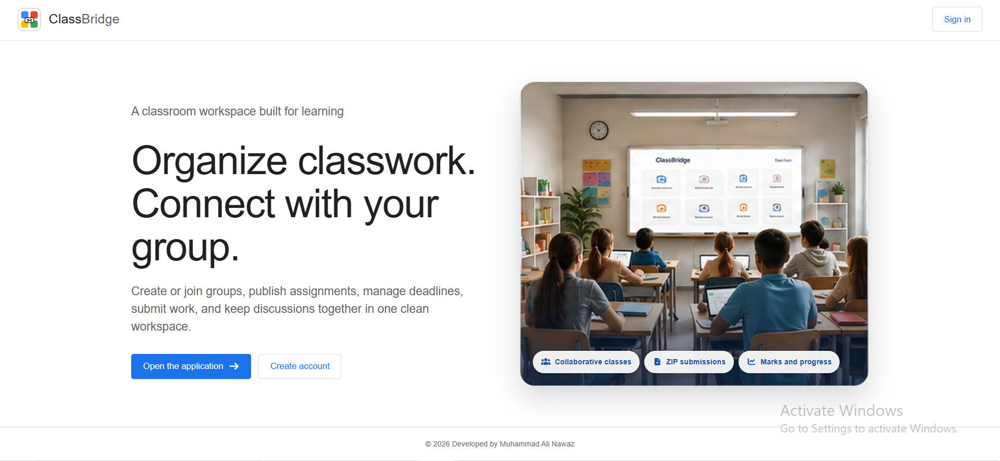
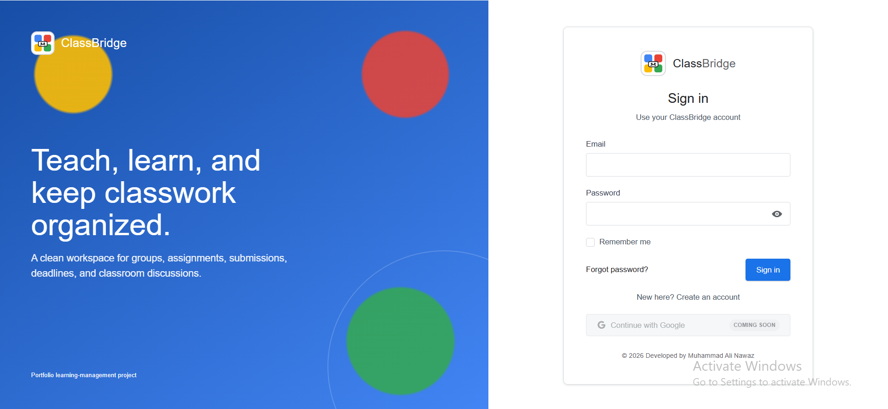
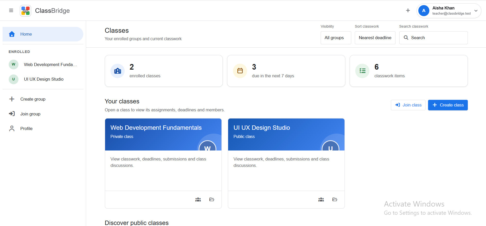
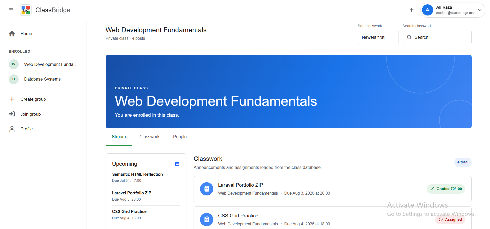

<h1 align="center">🎓 ClassBridge</h1>

<p align="center">
  <b>A secure and responsive classroom-collaboration platform built with Laravel 12, PHP 8.2, MySQL/MariaDB, Livewire 3, Blade, Tailwind CSS, and Vite.</b>
</p>

<p align="center">
  Teachers create classes and assignments, review private ZIP submissions, save marks, and return work. Students join classes, submit work, participate in discussions, and view released grades.
</p>

<p align="center">
  
  
  
  
</p>

<p align="center">
  
  
  
  
</p>

---

## 📸 Project Screenshots

| Landing Page | Login |
|---|---|
|  |  |

| Teacher Dashboard | Student Dashboard |
|---|---|
|  |  |

---

## 🚀 Project Overview

**ClassBridge** is a full-stack Laravel classroom application for two practical personas: **teachers** and **students**.

A teacher is the owner of a class. Class owners create classwork, manage invite codes, review submissions, download private ZIP files, record marks, return work, and delete their classes. Students explicitly join public classes or use an invite code for private classes, submit supported assignment types, replace ZIP work before the deadline, comment on classwork, and view marks after the teacher returns the work.

---

## 🌟 Key Highlights

- 🎓 Responsive classroom collaboration interface
- 🌐 Professional public landing page
- 🔐 Registration, login, logout, email verification, and password reset
- 👁️ Accessible animated password visibility controls
- 👤 Responsive account pill showing the signed-in user's identity
- 🏫 Public and private classes
- 🔑 Ten-character private-class invite codes
- 📢 Announcements
- ✅ Completion assignments
- ✍️ Text-answer assignments
- 🗜️ Private ZIP-file submissions
- 🔄 Submission replacement before deadline
- ⬇️ Authorized teacher/student downloads
- 🧮 Marks validation against assignment totals
- ↩️ Teacher Return Work and Undo Return workflow
- 💬 Scoped class comments
- 🗑️ Owner-only class deletion with confirmation
- 🛡️ Policies, scoped bindings, throttling, CSRF protection, and security headers
- 🔒 Private submission storage outside `public/`
- 🖼️ Secure profile-image validation and replacement cleanup
- 🧪 Feature, authorization, security, workflow, and UI-integrity tests
- 🎨 Laravel Pint formatting checks
- 🔍 Composer and npm security-audit commands
- ⚙️ GitHub Actions jobs for SQLite and MySQL
- 📸 Repository screenshots and favicon/application-icon metadata

---

## ✨ Features

### 🌐 Public Landing Page

| Feature | Description |
|---|---|
| Responsive Hero | Professional education-focused landing experience for desktop, tablet, and mobile |
| ClassBridge Branding | Original ClassBridge logo, favicon, application icons, and wordmark |
| Clear Access Paths | Direct Login and Register actions |
| Project Overview | Highlights class management, submissions, grading, and collaboration |
| Responsive Navigation | Layout adapts cleanly across common screen sizes |

### 🔐 Authentication and Account Security

| Feature | Description |
|---|---|
| Registration | New users can create accounts with normalized email addresses |
| Login and Logout | Laravel session authentication with session regeneration |
| Email Verification | Protected classroom routes require verified email addresses |
| Password Reset | Standard Laravel reset-link and password-update workflow |
| Password Confirmation | Sensitive authenticated flows can request password confirmation |
| Password Visibility | Animated accessible Show/Hide controls on all password forms |
| Login Throttling | Repeated authentication attempts are rate-limited |
| Password Hashing | Plain passwords are hashed once; existing hashes are not double-hashed |
| Google Authentication | Implementation retained but disabled by default behind an environment flag |
| CSRF Protection | Laravel CSRF protection remains active for browser mutations |

### 🏠 Dashboard

| Feature | Description |
|---|---|
| Class Summary | Displays enrolled classes, due-soon work, and current classwork totals |
| Class Cards | Opens classes and member lists from responsive dashboard cards |
| Upcoming Deadlines | Shows nearest dated assignments |
| Dynamic Filters | Filters and sorts loaded classwork without hardcoded records |
| Responsive Account Control | Shows avatar, full name, email, and account dropdown |
| Mobile Drawer | Responsive navigation for small screens |

### 🏫 Class Management

| Feature | Description |
|---|---|
| Create Class | Any verified user may create a class and becomes its teacher/owner |
| Public Class | Discoverable class that users join explicitly |
| Private Class | Invite-code-only membership |
| Member List | Authorized class participants can view class members |
| Owner Authorization | Only the class owner can create, edit, or delete its classwork |
| Delete Class | Confirmation-protected owner-only deletion |
| Related Cleanup | Memberships, posts, comments, submissions, and private ZIP files are removed |

### 📝 Classwork and Assignments

| Type | Student Action | Teacher Action |
|---|---|---|
| Announcement | Read and comment | Publish, edit, or delete |
| Completion | Mark as done or unsubmit | Review and return work |
| Text Answer | Submit or edit an answer | Review and return work |
| ZIP Submission | Upload or replace a ZIP before deadline | Download, grade, return, or undo return |

Assignment types are backed by `App\Enums\PostType`. Once submissions exist, the assignment type is locked. ZIP assignment totals are also locked after submissions exist to protect grading consistency.

### 🗜️ ZIP Submission and Grading

| Feature | Description |
|---|---|
| Private Storage | Files are stored on the private `submissions` disk |
| Generated Server Names | UUID-based storage names reduce collisions and path manipulation |
| Original Display Name | A sanitized original filename is retained for presentation/download |
| File Validation | ZIP extension, MIME validation, maximum size, and archive readability checks |
| Deadline Enforcement | Uploads and replacements close after the deadline |
| Replacement Cleanup | Replacing work deletes the old file and clears prior marks/return state |
| Teacher Download | Only the assignment owner may download another student's work |
| Draft Marks | Marks can be saved without immediately releasing them |
| Return Work | Returning work releases available marks to the student |
| Undo Return | Teacher may recall returned work for correction |

### 💬 Comments and Profiles

| Feature | Description |
|---|---|
| Class Comments | Members can discuss classwork |
| Scoped Updates | A comment cannot be updated through a different post |
| Profile Privacy | Unrelated users cannot enumerate private profile details |
| Shared-Class View | Classmates receive a limited profile view |
| Secure Images | Image type, content, ownership, size, and replacement cleanup are tested |

---

## 👥 Access Model

ClassBridge intentionally avoids a global administrator role.

| Persona | Access Model |
|---|---|
| 👩‍🏫 Teacher | Owns a class; manages its classwork, submissions, marks, return state, and deletion |
| 👨‍🎓 Student | Joins a class; views classwork, submits work, comments, and views returned marks |
| 🔒 Verified User | May create a class and thereby become that class's teacher |
| 🌐 Visitor | May view the landing page and authentication pages |

Teacher/student behavior is relationship-based rather than stored as a permanent global role. The same account can own one class and be a student member of another.

---

## 🛠 Technology Stack

| Layer | Technologies |
|---|---|
| Backend | PHP 8.2+, Laravel 12 |
| Web Frontend | Blade, Livewire 3, Wire Elements Modal 3 |
| Styling | Tailwind CSS 4, custom CSS, Flowbite, Font Awesome |
| Asset Build | Vite 8 and Laravel Vite Plugin |
| Database | MySQL or MariaDB for local/production-like use |
| Test Database | SQLite in memory by default; MySQL in a dedicated CI job |
| ORM | Laravel Eloquent models, relationships, casts, factories, and query scopes |
| Authentication | Laravel session authentication and email verification |
| OAuth | Laravel Socialite retained but disabled by default |
| Authorization | Laravel policies, Form Request authorization, and scoped bindings |
| File Storage | Public profile-image disk and private assignment-submission disk |
| Testing | PHPUnit 11 and Laravel testing utilities |
| Code Style | Laravel Pint |
| CI | GitHub Actions with SQLite and MySQL jobs |
| Package Management | Composer and npm |

---

## 🏗 Architecture Overview

```text
Browser
   ↓
Laravel Route
   ↓
Global Security + Database-Readiness Middleware
   ↓
Authentication + Email Verification
   ↓
Scoped Route-Model Binding
   ↓
Form Request Validation + Policy Authorization
   ↓
Controller
   ↓
Eloquent Models / Database Transaction / Filesystem
   ↓
Blade + Livewire Response
```

### Main Application Structure

```text
classbridge-laravel/
├── app/
│   ├── Enums/
│   ├── Http/
│   │   ├── Controllers/
│   │   ├── Middleware/
│   │   └── Requests/
│   ├── Livewire/
│   ├── Models/
│   ├── Policies/
│   ├── Providers/
│   └── Rules/
├── bootstrap/
├── config/
├── database/
│   ├── factories/
│   ├── migrations/
│   └── seeders/
├── docs/
│   └── screenshots/
├── public/
│   └── images/
├── resources/
│   ├── css/
│   ├── js/
│   └── views/
├── routes/
├── scripts/
├── storage/
├── tests/
│   ├── Feature/
│   └── Unit/
├── .github/workflows/ci.yml
├── .env.example
├── composer.json
├── package.json
└── README.md
```

---

## 🔄 Application Flows

### Class Creation Flow

```text
Verified User Opens Create Class
        ↓
Validate Name and Visibility
        ↓
Start Database Transaction
        ↓
Create Class and Invite Code
        ↓
Associate Creator as Owner
        ↓
Attach Creator as Member
        ↓
Redirect to Class Stream
```

### ZIP Assignment Flow

```text
Teacher Creates ZIP Assignment
        ↓
Validate Deadline and Total Marks
        ↓
Student Uploads Valid ZIP
        ↓
Store File on Private Disk
        ↓
Create or Replace Submission Record
        ↓
Teacher Downloads and Reviews Work
        ↓
Teacher Saves Draft Marks
        ↓
Teacher Returns Work
        ↓
Student Sees Returned Status and Marks
```

### Class Deletion Flow

```text
Class Owner Confirms Deletion
        ↓
Authorize Owner
        ↓
Collect Private Submission Paths
        ↓
Delete Class
        ↓
Foreign Keys Cascade Related Records
        ↓
Delete Private ZIP Files
        ↓
Redirect to Dashboard
```

---

## 🗄 Database Overview

### Main Tables

| Table | Purpose |
|---|---|
| `users` | Identity, credentials, verification, profile bio, and avatar metadata |
| `groups` | Class name, owner, visibility, and invite code |
| `group_user` | Class memberships |
| `posts` | Announcements and assignments |
| `post_user` | Student submissions, answers, files, grades, and return state |
| `comments` | Classwork discussion |
| `password_resets` | Password reset tokens |
| `failed_jobs` | Laravel failed-job records |

### Data Integrity

- User email addresses are normalized and unique
- Class invite codes are unique
- Class membership pairs are unique
- Assignment submission pairs are unique
- Post type values are constrained
- Related records use foreign keys and cascading deletion
- Submission type and ZIP total marks are protected after submissions exist
- Query indexes support classwork, comments, and submission lookups
- Uploaded assignment paths are scoped to their post and user records

---

## 🔐 Security Implementations

| Security Area | Implementation |
|---|---|
| Authentication | Laravel session authentication with session regeneration |
| Email Verification | Classroom routes require a verified user |
| Password Storage | Laravel hashing with double-hash prevention |
| Login Protection | Rate limiting for repeated login attempts |
| CSRF | Standard Laravel CSRF middleware |
| Authorization | Class, post, comment, profile, and submission policies |
| Scoped Binding | Nested group/post routes reject mismatched resources |
| File Uploads | Size, extension, MIME, archive readability, and ownership validation |
| Private Files | ZIP submissions are not exposed through the public storage link |
| Profile Privacy | Private profile details are limited by relationship |
| Security Headers | CSP, frame, referrer, content-type, permissions, and production HSTS headers |
| CSP Scripts | Inline scripts receive exact SHA-256 hashes; script attributes are blocked |
| Mass Assignment | Controlled model fillable fields |
| Seeder Safety | Demo seeding is rejected outside local/testing |
| Database Readiness | Missing tables render a controlled setup-required response |
| Output Escaping | Blade escaping is used for user-controlled page content |

---

## ⚡ Performance and Code Quality

- Uses eager loading for rendered relationships
- Uses pagination for classwork, comments, and submission review
- Uses database indexes for common filters and relationships
- Uses Form Requests for reusable validation and authorization
- Uses policies for ownership and membership boundaries
- Uses database transactions where multi-step writes must remain consistent
- Uses generated filenames for private uploads
- Uses reusable Blade components and layouts
- Uses responsive custom CSS rather than hardcoded screenshot layouts
- Uses PHPUnit feature tests for authentication, authorization, security, uploads, grading, deletion, privacy, and UI contracts
- Uses Laravel Pint for PHP formatting
- Uses lock files for reproducible Composer and npm installation
- Uses GitHub Actions for repeatable SQLite and MySQL verification

---

## 📡 Main Routes and System Areas

| Area | Purpose |
|---|---|
| `/` | Public ClassBridge landing page |
| `/login` | Sign in |
| `/register` | Create account |
| `/home` | Authenticated dashboard |
| `/group` | Create a class |
| `/group/join` | Join by invite code |
| `/group/{group}` | Class stream and classwork |
| `/group/{group}/user` | Class members |
| `/group/{group}/post/{post}` | Assignment or announcement details |
| `/group/{group}/post/{post}/submission` | Submit or replace ZIP work |
| `/group/{group}/post/{post}/submission/{submission}/download` | Authorized ZIP download |
| `/group/{group}/post/{post}/submission/{submission}/grade` | Save marks |
| `/group/{group}/post/{post}/submission/{submission}/return` | Return or recall work |
| `/user/{user}` | Authorized profile view |

---

## ⚙️ Installation Guide

### Requirements

- PHP 8.2 or newer
- Composer 2
- Node.js 20.19+ or 22.12+
- npm
- MySQL or MariaDB
- Git
- PHP extensions including `mbstring`, `fileinfo`, `openssl`, `pdo_mysql`, `pdo_sqlite`, `sqlite3`, `xml`, and `zip`
- XAMPP, Laragon, WAMP, Docker, or an equivalent environment

### 1️⃣ Clone the Repository

```bash
git clone https://github.com/YOUR_GITHUB_USERNAME/classbridge-laravel.git
cd classbridge-laravel
```

### 2️⃣ Install PHP Dependencies

```bash
composer install --no-interaction --prefer-dist
```

### 3️⃣ Install Frontend Dependencies

```bash
npm ci
```

### 4️⃣ Create the Environment File

Windows PowerShell:

```powershell
Copy-Item .env.example .env
```

Windows Command Prompt:

```bat
copy .env.example .env
```

macOS/Linux:

```bash
cp .env.example .env
```

### 5️⃣ Generate the Application Key

```bash
php artisan key:generate
```

### 6️⃣ Create and Configure the Database

```sql
CREATE DATABASE classbridge
    CHARACTER SET utf8mb4
    COLLATE utf8mb4_unicode_ci;
```

Update `.env`:

```dotenv
APP_NAME="ClassBridge"
APP_ENV=local
APP_DEBUG=true
APP_URL=http://127.0.0.1:8000

DB_CONNECTION=mysql
DB_HOST=127.0.0.1
DB_PORT=3306
DB_DATABASE=classbridge
DB_USERNAME=root
DB_PASSWORD=

GOOGLE_AUTH_ENABLED=false
DEMO_PASSWORD="Demo1234!"
```

Never commit the real `.env` file.

### 7️⃣ Run Migrations and Optional Demo Seeding

Create the schema without demo records:

```bash
php artisan migrate
```

Create the disposable local demonstration database:

```bash
php artisan migrate:fresh --seed
```

### 8️⃣ Create the Public Storage Link

```bash
php artisan storage:link
```

### 9️⃣ Build Frontend Assets

```bash
npm run build
```

For frontend development:

```bash
npm run dev
```

### 🔟 Start ClassBridge

```bash
php artisan serve --host=127.0.0.1 --port=8000 --no-reload
```

Open:

```text
http://127.0.0.1:8000
```

### Windows XAMPP One-Command Setup

Start MySQL through XAMPP, then run:

---

## 🔑 Demo Login Credentials

After `php artisan migrate:fresh --seed`:

```text
Teacher
Email: teacher@classbridge.test
Password: Demo1234!

Student
Email: student@classbridge.test
Password: Demo1234!
```

Additional local teacher and student accounts are seeded for realistic class and submission data. These credentials are for local demonstration only.

---

## 🧪 Testing and Verification

Run the complete Laravel suite:

```bash
php artisan test --stop-on-failure
```

Check PHP formatting:

```bash
php vendor/bin/pint --test
```

Validate Composer metadata and requirements:

```bash
composer validate --strict
composer check-platform-reqs
```

Audit PHP dependencies:

```bash
composer audit --locked --abandoned=report
```

Audit frontend dependencies and build production assets:

```bash
npm ci
npm audit --audit-level=moderate
npm run build
```

Verify Laravel boot and routes:

```bash
php artisan about
php artisan route:list
```

Run the complete Windows release verification:

```powershell
PowerShell -ExecutionPolicy Bypass -File .\scripts\verify-release.ps1
```

The repository currently contains more than 100 automated test methods covering authentication, email verification, password controls, class workflows, assignment submissions, grading, return state, deletion cleanup, comments, profiles, CSP, frontend assets, and release-script safety. Run the release verification before publishing a new result count.

---

## 🔁 Continuous Integration

`.github/workflows/ci.yml` runs on pushes and pull requests.

The SQLite job verifies:

- Composer metadata and locked dependency installation
- PHP platform requirements
- Composer security audit
- npm installation, audit, and Vite build
- Laravel boot and route registration
- Migration, rollback, and re-migration lifecycle
- Complete automated suite
- Laravel Pint

The MySQL job verifies:

- MySQL 8.4 service startup
- Migration and rollback lifecycle
- Complete suite using MySQL
- Laravel Pint
- Current frontend production build

---

## 🏗 Production Build and Deployment Checklist

Recommended production values:

```dotenv
APP_ENV=production
APP_DEBUG=false
APP_URL=https://your-domain.example
GOOGLE_AUTH_ENABLED=false
SESSION_SECURE_COOKIE=true
```

Deployment commands:

```bash
composer install --no-dev --optimize-autoloader --no-interaction
npm ci
npm run build
php artisan migrate --force
php artisan storage:link
php artisan optimize
```

Additional requirements:

- Configure Apache or Nginx with `public/` as the document root
- Use HTTPS
- Use unique database credentials
- Keep `APP_DEBUG=false`
- Configure mail before enabling production email verification/reset delivery
- Keep demo data and demo credentials out of production
- Configure writable permissions for `storage/` and `bootstrap/cache/`
- Configure backups, monitoring, error reporting, and log rotation
- Review CSP requirements before adding new inline scripts or third-party services
- Never commit `.env`, logs, caches, uploaded files, local databases, `vendor`, or `node_modules`

---

## ✅ Portfolio Verification Checklist

- [x] Laravel 12 MVC structure
- [x] Responsive Blade and Livewire interface
- [x] Public landing page and project screenshots
- [x] Registration, login, logout, verification, and password reset
- [x] Password visibility controls
- [x] Public/private classes and invite-code membership
- [x] Relationship-based teacher/student access
- [x] Announcements and multiple assignment types
- [x] Private ZIP submissions and replacement
- [x] Teacher downloads, marks, Return Work, and Undo Return
- [x] Owner-only class deletion and file cleanup
- [x] Scoped comments and profile privacy
- [x] Policies, Form Requests, throttling, and security headers
- [x] Database constraints and indexes
- [x] Deterministic local demo data
- [x] PHPUnit feature/security/UI tests
- [x] Laravel Pint
- [x] Composer/npm audit commands
- [x] SQLite and MySQL GitHub Actions jobs
- [x] MIT licensing and upstream attribution
- [x] Repository cleanup rules

---

## 👨‍💻 Maintainer

**Muhammad Ali Nawaz**  
PHP / Laravel Developer  

---

## 📄 License

ClassBridge is distributed under the [MIT License](LICENSE).

---

<p align="center">
  <b>⭐ If you find ClassBridge useful, consider starring the repository.</b>
</p>
